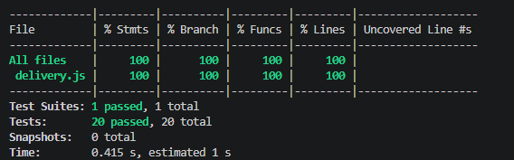

# APS Delivery - Teste de Software

## Sobre o projeto

Este projeto foi desenvolvido para a disciplina de Teste de Software.
O objetivo é implementar funções de um sistema de delivery e testar
seus resultados utilizando Jest.

## Integrantes

- Belizário Moreira Barreto Neto

## Resumo

Escrever 20 testes automatizados com Jest para 5 funções do software de delivery (autenticar, forcaSenha, podeLogar, calcularFrete, aplicarCupom) e implementar as funções até todos os testes passarem, com 100% de cobertura.

## Como executar

Instale as dependências: npm install

Execute os testes: npx jest

Para verificar a cobertura: npx jest --coverage

## Funcionalidades testadas

- Autenticação de usuários
- Verificação da força da senha
- Verificação de permissão de login
- Cálculo do frete
- Aplicação de cupons

